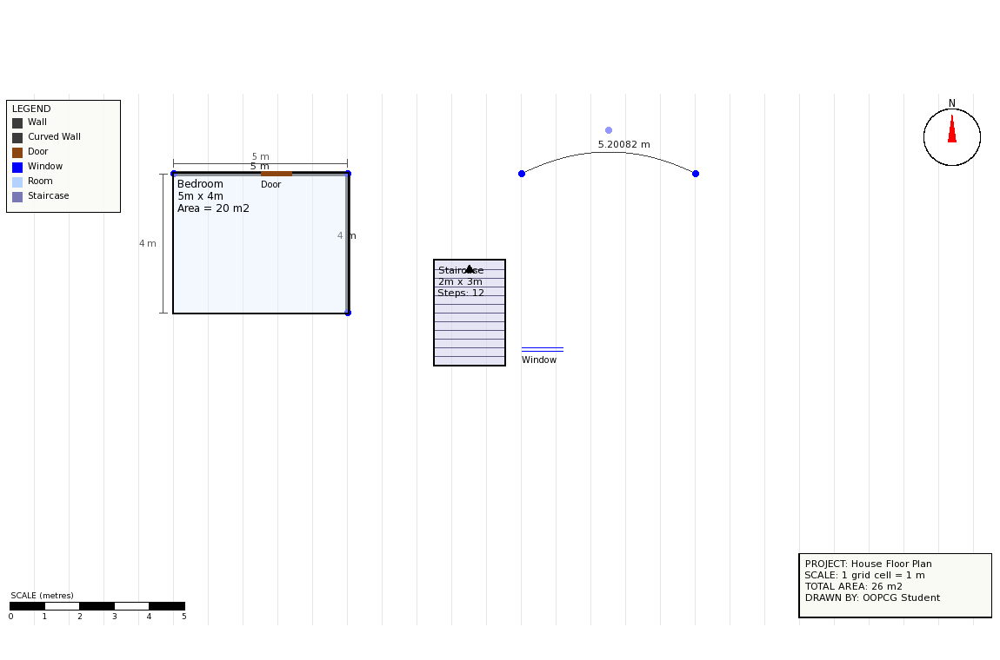

# 2D House Floor Plan Designer — OOPCG College Project (C++ / SFML 3)



A 2D floor-plan drawing tool: walls, curved walls, rooms (Bedroom / Living
Room / Kitchen / Bathroom), a staircase, doors and windows on a 1-metre
grid — with live dimensions, per-room area, total house area, a north
compass, a scale bar, a title block, a legend, undo, and PNG/report export.

---

## 1. Library used, and why

**SFML 3** (Simple and Fast Multimedia Library) — a small, beginner-friendly
C++ library for 2D graphics, windowing and input.

| SFML piece | Used for |
|---|---|
| `sf::RenderWindow` | Opens the window; everything is drawn onto it each frame |
| `sf::RectangleShape`, `sf::CircleShape`, `sf::ConvexShape` | Rooms, staircases, handles, compass needle, stair-up arrow |
| `sf::Vertex` + `sf::PrimitiveType::Lines/LineStrip` | Walls, windows, the grid, curved-wall Bézier curves, dimension lines |
| `sf::Text` + `sf::Font` | All labels: rooms, dimensions, legend, title block, status bar |
| `sf::Event`, `sf::Mouse` | Reading mouse clicks / movement / window-close events |
| `sf::Texture` + `sf::Image` | Capturing the window for the PNG **Export** feature |

**Why SFML and not a bigger engine/framework:** SFML gives you a canvas,
2D drawing primitives and raw input events — nothing more. You still
write your own coordinate math, class hierarchy and hit-testing, which
is exactly what an OOPCG viva needs to show.

### Install SFML 3

```bash
# Ubuntu / Debian (build from source if your repo only has SFML 2.x — see note below)
sudo apt-get install cmake g++ libx11-dev libxrandr-dev libxcursor-dev \
                      libxi-dev libudev-dev libgl1-mesa-dev libfreetype-dev

# macOS (Homebrew)
brew install sfml

# Windows — use vcpkg (recommended)
git clone https://github.com/microsoft/vcpkg.git C:\vcpkg
C:\vcpkg\bootstrap-vcpkg.bat
C:\vcpkg\vcpkg install sfml:x64-windows
C:\vcpkg\vcpkg integrate install
```

> **Note:** Ubuntu's default package manager may still only offer SFML 2.x.
> This project needs SFML **3.x**. On Linux, either build SFML 3 from
> source (clone `https://github.com/SFML/SFML`, tag `3.0.0`, then the
> usual `cmake .. && cmake --build . && sudo cmake --install .`), or use
> a package manager that has it (vcpkg works on Linux too).

### Build & run

```bash
mkdir build && cd build

# Linux/macOS (SFML installed system-wide or via vcpkg)
cmake ..
cmake --build .
./HouseFloorPlanner

# Windows (vcpkg)
cmake .. -DCMAKE_TOOLCHAIN_FILE=C:/vcpkg/scripts/buildsystems/vcpkg.cmake
cmake --build . --config Release
.\Release\HouseFloorPlanner.exe
```

If no text appears on screen, copy any `.ttf` font file to
`build/assets/font.ttf` (see `Fonts.h` — it searches common system font
paths automatically first).

> **Note on Export folder location:** When you click the **Export** button on the toolbar, the application writes `floorplan_<timestamp>.png` and `floorplan_report_<timestamp>.txt` into an `exports/` folder created **in the current working directory from which the executable is launched**.
> - If launched from `build/` (e.g. `./HouseFloorPlanner` on Linux/macOS), exported files are created in `build/exports/`.
> - If launched on Windows from `build/` via `.\Release\HouseFloorPlanner.exe`, exported files are created in `build/Release/exports/`.
> Check the directory containing your running `.exe` binary to find exported snapshots and dimension reports!

---

## 2. Folder structure

```
HouseFloorPlanner/
├── CMakeLists.txt
├── README.md
├── .gitignore
├── docs/
│   ├── index.html        # GitHub Pages showcase page (see Section 10)
│   └── screenshot.png
├── include/
│   ├── Grid.h             # pixel<->metre conversion, grid snapping, wall thickness
│   ├── Fonts.h             # shared font loader
│   ├── Shape.h             # ABSTRACT BASE CLASS
│   ├── Wall.h               # straight wall (with real thickness)
│   ├── CurvedWall.h         # curved wall (quadratic Bezier) - NEW
│   ├── Door.h / Window.h
│   ├── Room.h               # with per-side dimension lines
│   ├── Staircase.h          # NEW
│   ├── FloorPlan.h          # COMPOSITION: owns all shapes, + Undo
│   ├── Drafting.h           # compass / scale bar / title block / legend / dimension lines - NEW
│   └── Export.h             # PNG + text report export - NEW
└── src/   (matching .cpp files + main.cpp)
```

---

## 3. Class diagram

```
                     Shape  (abstract base class)
                    ───────────────────────────
                    - x, y : float             (protected)
                    - selected : bool          (protected)
                    - rotationDegrees : float  (protected)
                    ───────────────────────────
                    + draw() / contains() / move()
                    + getArea() / getInfo()       = 0 each
                    + getHandleAt() / onHandlePressed() / dragHandle()
                    + drawHandles()
                    + getRotation() / setRotation()
                            △
      ┌─────────┬──────────┬─────────┬──────────┬───────────┐
      │         │          │         │          │           │
    Wall   CurvedWall     Door     Window      Room      Staircase
  ───────  ───────────  ───────  ─────────  ──────────  ───────────
  start/   start/control  width    width     roomType     width/height
  end pt   /end points  (0.6-2m) (0.4-3m)   width/height numSteps
  thick-   handles:     rotation rotation   (min 1m)     (min 1m)
  ness     start/ctrl/  (0°/90°) (0°/90°)   rotation     rotation
  handles: end          handles: handles:   (15° snap)   (15° snap)
  start/                resize/  resize/    handles:     handles:
  end                   rotate   rotate     4 corners +  4 corners +
                                            rotate       rotate
                                            getArea()=w*h getArea()=w*h


           FloorPlan  (COMPOSITION, not inheritance)      Drafting  (free functions,
          ──────────────────────────────                 NOT a Shape subclass -
          - shapes : vector<unique_ptr<Shape>>            see Section 8)
          ──────────────────────────────                 ──────────────────────
          + addShape()/removeShape()/clear()/undoLast()   + drawCompass()
          + drawAll()  <- loops, shape->draw()             + drawScaleBar()
          + findShapeAt(point)                             + drawTitleBlock()
          + getTotalArea()  <- sums shape->getArea()        + drawLegend()
                                                             + drawDimensionLine(..., states)
```

`FloorPlan` **HAS-A** collection of `Shape`s (composition).
`Wall / CurvedWall / Door / Window / Room / Staircase` **IS-A** `Shape` (inheritance).

---

## 4. Responsibilities of each class

| Class | Responsibility |
|---|---|
| `Shape` | Common abstract interface for all floor-plan objects; declares pure virtual functions (`draw`, `contains`, `move`, `getArea`, `getInfo`), stores `(x, y)`, `selected`, and `rotationDegrees`, and defines polymorphic handle methods (`getHandleAt`, `onHandlePressed`, `dragHandle`, `drawHandles`) for interactive resizing and rotating. |
| `Wall` | A straight, thick wall between two endpoints; reports its own length; provides start/end handles to resize length and re-orient angle simultaneously. |
| `CurvedWall` | A curved wall defined by a quadratic Bézier curve; reports arc length; provides start, control, and end handles to independently reshape curve bulge and endpoints. |
| `Door` | Architectural door leaf symbol; provides a far-end handle to drag-adjust width ($0.6 - 2.0\text{ m}$) and a rotate handle to toggle orientation between horizontal ($0^\circ$) and vertical ($90^\circ$). |
| `Window` | Dual-line "glass" opening symbol; provides a far-end handle to drag-adjust width ($0.4 - 3.0\text{ m}$) and a rotate handle to toggle horizontal/vertical orientation ($0^\circ / 90^\circ$). |
| `Room` | A rectangle with room type and side dimensions; calculates area; provides 4 corner handles for opposite-corner fixed resizing (minimum 1 grid cell) and a top-centre rotate handle for $15^\circ$-snapped rotation around its centre. |
| `Staircase` | A flight of stairs with auto-generated steps and an "UP" arrow; counts toward area; provides 4 corner handles (dynamically recalculating step count on resize) and a top-centre $15^\circ$ rotate handle. |
| `FloorPlan` | Owns and manages all shapes via `std::vector<std::unique_ptr<Shape>>`; draws them polymorphically; sums total house area; supports undo and clearing. |
| `Drafting` | Free functions drawing fixed sheet furniture: compass, scale bar, title block, legend, and dimension lines (with `sf::RenderStates` support for rotating alongside rooms). |
| `Export` | Captures window snapshot to PNG (`sf::Texture` $\to$ `sf::Image`) and generates a plain-text dimension and area report. |
| `main.cpp` | Window lifecycle, dual-row toolbar, status bar, and mouse-event dispatcher (distinguishing handle dragging from whole-shape translation under the Select tool). |

---

## 5. User workflow

1. Pick a tool from the two-row toolbar.
2. **Wall:** click start point, click end point.
3. **Curve:** click start, click end, click a third point to bend the wall (quadratic Bézier control point).
4. **Room types / Stairs:** click-drag a rectangle; release to place it (snapped to 1-metre grid cells).
5. **Door / Window:** single click to place on the canvas.
6. **Select & Manipulate (Figma/PowerPoint Model):**
   - Click any shape with the **Select** tool to select it (turns red). When selected under the Select tool, interactive manipulation handles appear:
     - **Resize:** Drag an endpoint handle on a Wall, any of the 3 points on a CurvedWall, any of the 4 corner square handles on a Room/Staircase (resizes with opposite corner fixed, minimum 1 grid cell), or the far-end square handle on a Door ($0.6 - 2.0\text{ m}$) or Window ($0.4 - 3.0\text{ m}$).
     - **Orient / Rotate:** Drag the green circular handle above a Room or Staircase to rotate it around its centre in 15° snapped steps; click/drag the rotate handle on a Door or Window to toggle between horizontal ($0^\circ$) and vertical ($90^\circ$); or drag a Wall's endpoint to alter its direction angle.
     - **Move:** Click and drag anywhere on the shape's body (away from any handle) to translate the whole object across the floor plan.
   - Click empty canvas space or switch to another tool to deselect (handles disappear).
7. **Delete:** click a shape to remove it.
8. **Undo:** removes the most recently added shape.
9. **Export:** saves `exports/floorplan_<timestamp>.png` and `exports/floorplan_report_<timestamp>.txt` next to the running executable.
10. **Clear:** wipes the whole plan.
11. Status bar always shows the selected shape's live measurements, orientation, and **Total House Area** (rooms + staircases).

---

## 6. How measurements are calculated

- **Scale:** `Grid::PIXELS_PER_METER = 40` → 1 grid cell = 1 metre.
- **Wall length:** Euclidean distance between its two points, in metres — `Wall::getLength()`, computed fresh every call (never stored, so never stale).
- **Curved wall length:** the Bézier curve is sampled into 24 straight segments; their lengths are summed — the standard way to measure a parametric curve numerically.
- **Room area:** `widthMeters * heightMeters`, in `Room::getArea()`.
- **Room's 4 side lengths:** for a rectangle, opposite sides are always equal, so `width` fully describes the top AND bottom edge, and `height` fully describes the left AND right edge. `Room::getInfo()` names all 4 sides explicitly; `Room::draw()` shows two proper dimension lines (top width, left height) since drawing the same number twice on opposite sides would just be visual clutter.
- **Staircase area:** same formula as Room — a staircase occupies real floor space, so it counts toward the total.
- **Total house area:** `FloorPlan::getTotalArea()` sums `shape->getArea()` over every shape — walls/curved walls/doors/windows return `0` automatically, no `if (isRoom)` check anywhere (polymorphism doing the filtering).
- **Rotation angle as shape state:** Every shape has a stored rotation angle `rotationDegrees` (a `protected float` in the `Shape` base class, initialized to `0.f`). Accessible via `getRotation()` and `setRotation()`.
- **How rotation affects `getInfo()`:** When a shape is rotated, its rotation angle or orientation is included in its status string:
  - `Room` and `Staircase` append ` | Rot: <angle> deg` when `rotationDegrees != 0`.
  - `Door` and `Window` report ` | Orientation: Horizontal` (0°) or `Vertical` (90°).
  - `Wall` and `CurvedWall` derive their angle dynamically from endpoint coordinates without needing a separate rotation field.
- **Opposite-corner invariant resizing:** When dragging a corner handle on a Room or Staircase, the new width and height are calculated while mathematically holding the diagonally opposite corner invariant in world coordinates.

---

## 6.1. Resize and Orient interaction (handles, constraints & transforms)

All shapes support interactive **resizing** and **orientation (rotation)** via visual manipulation handles.

### Selection & Handle Lifecycle (Figma / PowerPoint Model)
- **Active state:** Handles appear **only** on the currently selected shape, and **only** while the **Select** tool is active.
- **Deactivation:** Clicking empty canvas space or switching to any other toolbar tool immediately deselects the shape and hides all handles.
- **Differentiating drags:** When the user clicks with the Select tool:
  - If the mouse hits a handle, `activeHandle` is set and moving the mouse invokes `selectedShape->dragHandle()`.
  - If the mouse hits the body of the shape (away from any handle), whole-shape translation (`selectedShape->move(dx, dy)`) is engaged.

### Per-Shape Handle Behavior & Constraints

#### 1. Wall
- **Handles:** Two circular endpoint handles (radius $5\text{ px}$, blue with white outline) at `startPoint` (Handle 0) and `endPoint` (Handle 1).
- **Drag Behavior:** Dragging an endpoint moves **only** that specific point. Whole-shape dragging (clicking anywhere along the wall body) moves both points simultaneously.
- **Resize & Re-orient:**
  - Length is dynamically computed via Euclidean distance $\sqrt{\Delta x^2 + \Delta y^2}$ in `Wall::getLength()`.
  - Angle is dynamically computed via $\text{atan2}(\Delta y, \Delta x)$ in `Wall::draw()`. Moving an endpoint simultaneously resizes and re-orients the wall in a single natural gesture.
- **OOP Concepts:**
  - *Polymorphism:* Overrides `getHandleAt()`, `dragHandle()`, and `drawHandles()`.
  - *Encapsulation:* Length and angle are never stored; they are always calculated on the fly from private `startPoint` and `endPoint`.
- **CG Concepts:**
  - *Vector representation & 2D Affine Transform:* A thick wall is rendered as a rectangle rotated by $\text{atan2}$ and translated to `startPoint`.

#### 2. CurvedWall
- **Handles:** Three circular handles (radius $5\text{ px}$) — `startPoint` (Handle 0, blue), `controlPoint` (Handle 1, light purple `sf::Color(140, 140, 255)`), and `endPoint` (Handle 2, blue).
- **Visual Control Cage:** When selected, a light guide polygon (control cage) connects `startPoint` $\to$ `controlPoint` $\to$ `endPoint`, visually exposing the Bézier control polygon.
- **Drag Behavior:** All three points are dragged independently. Dragging `controlPoint` alters the curve's curvature/bulge without displacing its endpoints; dragging `startPoint` or `endPoint` adjusts the curve's span and anchors.
- **OOP Concepts:**
  - *Polymorphism:* Implements the uniform `Shape` handle interface, allowing `main.cpp` to manipulate Bézier curves without knowing it is dealing with a curved wall.
- **CG Concepts:**
  - *Parametric Curves (Quadratic Bézier):* $B(t) = (1-t)^2 P_0 + 2(1-t)t P_1 + t^2 P_2$. Reshaping the control point interactively recalculates the sampled polyline.

#### 3. Room (Bedroom, Living Room, Kitchen, Bathroom)
- **Handles:**
  - Four corner resize handles: small white squares ($8\times 8\text{ px}$) with blue outlines at Top-Left (0), Top-Right (1), Bottom-Right (2), and Bottom-Left (3).
  - One rotate handle: circular green node ($4.5\text{ px}$ radius) suspended on a $24\text{ px}$ thin stem line above the top-centre edge.
- **Resize Drag Behavior (Opposite-Corner Invariance):** Dragging any corner handle resizes the room (`widthMeters` and `heightMeters`) while keeping the **diagonally opposite corner strictly fixed in world space** (e.g. dragging Top-Left keeps Bottom-Right locked).
- **Minimum Size Limit:** Capped at a minimum of **1 grid cell** ($1.0\text{ m} = 40\text{ px}$), cleanly rounded to $0.1\text{ m}$ increments so architectural labels remain neat and readable.
- **Rotate Drag Behavior:** Dragging the rotate handle rotates the shape around its own geometric centre in **15-degree snapped increments** ($0^\circ, 15^\circ, 30^\circ, \dots, 345^\circ$).
- **OOP Concepts:**
  - *Encapsulation:* Rotation angle is encapsulated in `Shape::rotationDegrees` (protected) and manipulated via `getRotation()` / `setRotation()`. Dimensions remain private in `Room`.
  - *Polymorphism:* `contains()` and `draw()` are overridden to handle arbitrary rotation without changing the external interface.
- **CG Concepts:**
  - *Center-Origin Affine Transform:* `rect.setOrigin({wPx / 2.f, hPx / 2.f})`, `rect.setPosition(center)`, and `rect.setRotation(sf::degrees(rotationDegrees))` rotate the rectangle. Child elements (labels and dimension lines) receive the exact same coordinate transformation via `sf::RenderStates` ($T(C) R(\theta) T(-C)$) so they rotate together.
  - *Inverse-Rotate-Then-Test ($R(-\theta)$):* In `contains()`, the world click point is transformed by the inverse rotation matrix around the rectangle's centre. Hit-testing is then evaluated as a simple, fast Axis-Aligned Bounding Box (AABB) test in local model space.
  - *Opposite-Corner Invariant Mapping:* In `dragHandle()`, the mouse vector relative to the fixed opposite corner is rotated into local space via $R(-\theta)$ to compute updated dimensions, after which the new center is mapped back to world space via $R(\theta)$.

#### 4. Staircase
- **Handles:** Identical to `Room` (4 square corner resize handles + 1 top-centre circular rotate handle on a stem).
- **Resize Drag Behavior:** Resizes width and height with the opposite corner fixed (minimum 1 grid cell, $1.0\text{ m}$).
- **Dynamic Step Recalculation:** As the staircase is resized, `dragHandle()` dynamically recomputes the number of steps: `numSteps = std::max(3, std::min(16, static_cast<int>(longerSide / 0.25f)))`, maintaining a realistic tread depth.
- **Rotate Drag Behavior:** Rotates around its own centre in **15-degree snapped increments**.
- **OOP Concepts:**
  - *Polymorphism:* Shares the exact same interface and handle structure as `Room`, but overrides `draw()` to render step treads and an "UP" arrow that rotate with the flight.
- **CG Concepts:**
  - *Composite Geometry Transformation:* The bounding box, parallel tread lines, directional convex arrow, and text label all transform seamlessly under the same affine transformation matrix.

#### 5. Door
- **Handles:**
  - One resize handle: square ($8\times 8\text{ px}$, white fill, blue outline) at the far end of the door leaf.
  - One rotate handle: green circular node ($4.5\text{ px}$ radius) on an $18\text{ px}$ stem line above the leaf's midpoint.
- **Resize Drag Behavior:** Dragging the far-end handle adjusts width along the door's axis, clamped to standard architectural door limits: **$0.6\text{ m}$ to $2.0\text{ m}$** (in clean $0.05\text{ m}$ / $5\text{ cm}$ increments).
- **Rotate Drag Behavior:** Clicking the rotate handle toggles orientation between **Horizontal ($0^\circ$) and Vertical ($90^\circ$)** in 90-degree steps.
- **OOP Concepts:**
  - *Encapsulation:* Door width is validated and clamped to $[0.6, 2.0]\text{ m}$; orientation is tracked in `rotationDegrees`.
- **CG Concepts:**
  - *Anchor-Point Rotation:* Rotates around the hinge placement point $(x, y)$.
  - *1D Local Projection:* Dragging projects mouse coordinates along the door's rotated direction vector using inverse rotation $R(-\theta)$.

#### 6. Window
- **Handles:**
  - One resize handle: square ($8\times 8\text{ px}$) at the far end.
  - One rotate handle: green circular node on an $18\text{ px}$ stem line above the midpoint.
- **Resize Drag Behavior:** Dragging the far-end handle adjusts width along the window's axis, clamped between **$0.4\text{ m}$ and $3.0\text{ m}$** (in clean $0.05\text{ m}$ increments).
- **Rotate Drag Behavior:** Clicking the rotate handle toggles between **Horizontal ($0^\circ$) and Vertical ($90^\circ$)**.
- **OOP Concepts:**
  - *Polymorphism:* Custom `drawHandles()`, `dragHandle()`, and `contains()` implementations tailored to dual-line glass symbols.
- **CG Concepts:**
  - *Parallel Line Coordinate Transformation & Inverse Hit-Testing:* Evaluates hit-testing in local unrotated space around the anchor point.

---

## 7. OOP concepts — exactly where they appear

| Concept | Where |
|---|---|
| **Encapsulation** | `Shape::x,y,selected,rotationDegrees` are `protected`; every subclass's own fields (`Wall`'s points, `Room`'s dimensions, `Staircase`'s `numSteps`, `Door`/`Window`'s widths) are `private`. Length and area are never stored raw — always **computed** dynamically through methods. Width limits (Door: $0.6 - 2.0\text{ m}$, Window: $0.4 - 3.0\text{ m}$) and minimum room size (1 grid cell) are strictly encapsulated and enforced inside `dragHandle()`. |
| **Inheritance** | `Wall`, `CurvedWall`, `Door`, `Window`, `Room`, `Staircase` all write `: public Shape`. |
| **Polymorphism** | `FloorPlan::drawAll()`, `getTotalArea()`, and `Export::exportAll()` all loop over `vector<unique_ptr<Shape>>` calling `shape->draw()` / `getArea()` / `getInfo()` — the correct override for each concrete type runs automatically. Additionally, `Shape` declares a polymorphic handle manipulation interface (`getHandleAt()`, `onHandlePressed()`, `dragHandle()`, `drawHandles()`), enabling `main.cpp` to handle resize and rotation across all shapes through base-class pointers without RTTI or `dynamic_cast`. `contains()` is polymorphically overridden with inverse-rotation transforms. |
| **Abstraction** | `Shape` declares pure virtual (`=0`) functions; it can never be instantiated directly. |
| **Composition** | `FloorPlan` **HAS-A** `vector<Shape>`, not itself a `Shape`. `Drafting`'s free functions are a second, simpler example: they are deliberately **not** Shape subclasses, because a compass or a title block is sheet furniture, not a house part the user places/moves — a good design judgement call worth mentioning in viva. |

---

## 8. Computer Graphics concepts — exactly where they appear

| Concept | Where |
|---|---|
| **2D coordinate system** | Every shape stores `(x, y)` in screen-pixel space |
| **World ↔ screen conversion** | `Grid::metersToPixels()` / `pixelsToMeters()` |
| **Points / Lines** | `Wall` endpoints, `sf::PrimitiveType::Lines`, the grid, dimension lines, Bezier control cage |
| **Rectangles** | `Room`, `Staircase`, buttons, title block, legend, corner resize handles |
| **Rotation + Translation (2D Affine Transform)** | `Wall::draw()` builds a rectangle and applies `setRotation(sf::degrees(angle))` + `setPosition()`. `Room` and `Staircase` place the transformation origin at their geometric centre and apply affine rotation matrix $T(C) R(\theta) T(-C)$ via `sf::RenderStates` so the rectangle, labels, dimension lines, steps, and UP arrows all rotate together. |
| **Inverse Coordinate Transform ($R(-\theta)$)** | Model-space hit-testing in `Room::contains()`, `Staircase::contains()`, `Door::contains()`, and `Window::contains()`. The world-space mouse click point is transformed by the inverse rotation matrix around the shape's centre/anchor before executing an Axis-Aligned Bounding Box (AABB) check. |
| **Parametric curves (Bézier)** | `CurvedWall` — quadratic Bézier formula $B(t) = (1-t)^2 P_0 + 2(1-t)t P_1 + t^2 P_2$, sampled into a 24-segment line strip. An interactive control cage connects start, control, and end handles. |
| **Angular Snapping & Constraints** | `Room` and `Staircase` snap rotation to 15-degree increments. `Door` and `Window` snap orientation in 90-degree steps (horizontal/vertical). Resizing in rotated coordinates maps mouse offset via $R(-\theta)$ and recomputes the new center to keep the diagonally opposite corner fixed in world space. |
| **Scaling** | The single constant `PIXELS_PER_METER` scales every metre to a fixed pixel count |
| **Grid & snapping** | `Grid::snap()` |
| **Mouse interaction** | `sf::Event::MouseButtonPressed/Released/Moved` |
| **Hit-testing** | Point-to-segment distance (`Wall`, `CurvedWall`), inverse-transformed bounding-box containment (`Room`, `Door`, `Window`, `Staircase`), handle point-radius distance testing. |
| **Render-to-image** | `Export`'s PNG capture via `sf::Texture::update(window)` → `copyToImage()` → `saveToFile()` |

---

## 9. 2–3 minute demo script

> "This is a 2D house floor plan designer with a fixed 1-metre grid scale.
> I draw a wall by clicking a start and end point — its length is
> calculated automatically. The Curve tool adds a third click to bend a
> wall into a curved wall, useful for bay windows or rounded porches,
> using a quadratic Bézier curve under the hood. Dragging out a Bedroom
> or Kitchen creates a Room with its width, height and area shown, plus
> proper dimension lines like a real architectural drawing. The Stairs
> tool places a staircase with automatically generated steps and an UP
> arrow, which also counts toward the total house area.
> When I click on any shape with the Select tool, interactive manipulation
> handles appear — exactly like in Figma or AutoCAD: I can drag any corner
> to resize a room or staircase while keeping the opposite corner locked in
> place, or drag the green top handle to rotate the entire room around its
> centre in 15-degree increments. Doors and windows can be resized along their
> axis or toggled between horizontal and vertical with a single click. Walls
> and curved walls allow independent dragging of endpoints and Bézier control
> points. I can move, delete, or undo any object, and the plan always carries
> a north compass, a printed scale bar, a title block and a legend — the
> standard furniture of a real civil drawing sheet. Finally, Export
> saves the whole plan as a PNG image plus a text report listing every
> object's exact measurements and rotation angles. Underneath, everything is
> a subclass of one common Shape class, so the program treats every object
> polymorphically — one draw() loop renders all of them, and one
> getArea() loop calculates the total house area, without ever checking
> what type each object is."

---

## 10. Pushing this to GitHub

Run these from inside the `HouseFloorPlanner` folder (the one with
`CMakeLists.txt` in it):

```bash
git init
git add .
git commit -m "Initial commit: 2D house floor plan designer (OOPCG project)"
```

Then on GitHub.com: click **New repository**, name it (e.g.
`house-floor-plan-designer`), leave it empty (no README/license — you
already have one), and copy the commands it shows you, which will look
like:

```bash
git remote add origin https://github.com/<your-username>/house-floor-plan-designer.git
git branch -M main
git push -u origin main
```

`.gitignore` is already set up to exclude `build/` and `exports/`, so
only your source code gets pushed.

---

## 11. "Deploying" this project — what's actually possible

This is a **native desktop application** (it opens its own window via
SFML), not a website — so it can't be "deployed" the way a web app is,
without a substantial rewrite (porting it to run in a browser via
WebAssembly, which is a much bigger undertaking than this project
needs). Here are the two realistic, honest options for showing it off
online:

**Option A — GitHub Releases (a downloadable build, the standard way
to "deploy" a desktop app)**
1. Build a `Release` binary on your own machine (`cmake --build . --config Release`).
2. On your GitHub repo page, click **Releases → Create a new release**.
3. Tag it (e.g. `v1.0`), add a short description, and **drag your
   built `.exe`** (and the SFML `.dll` files next to it, zipped
   together) into the upload box.
4. Publish — now anyone has a direct download link to a working build.

**Option B — A GitHub Pages showcase page (a live webpage, even
though the app itself can't run in it)**
This repo already includes `docs/index.html` — a one-page site with a
screenshot, feature list and a download button pointing at your
Release. To turn it on:
1. Push your code to GitHub (Section 10).
2. On GitHub, go to **Settings → Pages**.
3. Under "Build and deployment", set **Source: Deploy from a branch**,
   branch **main**, folder **/docs**, then Save.
4. After a minute, your page is live at
   `https://<your-username>.github.io/<repo-name>/`.

Doing **both** gives your mam a live link she can open (the showcase
page) with a working download (the Release) — which is the honest,
correct equivalent of "deploying" a desktop C++ application.

---

## 12. Likely viva questions & simple answers

1. **Why is `Shape` abstract?** So a meaningless plain "shape in general" can never be created — only a specific shape (wall, room...) can, and every subclass is forced to define its own `draw()`, `getArea()`, etc.
2. **Where is encapsulation used?** `Shape::x/y/selected` and every subclass's own fields are `protected`/`private`; length/area are always computed through a method, never stored raw.
3. **Where is inheritance used?** `Wall`, `CurvedWall`, `Door`, `Window`, `Room`, `Staircase` all inherit from `Shape`.
4. **Where is polymorphism used, concretely?** `FloorPlan::drawAll()` and `Export::exportAll()` loop over `vector<unique_ptr<Shape>>` and call `shape->draw()` / `shape->getInfo()` — the correct version for each real type runs automatically.
5. **Difference between inheritance and composition here?** Inheritance = "is-a" (`Wall` **is a** `Shape`). Composition = "has-a" (`FloorPlan` **has a** collection of `Shape`s; it is not one itself).
6. **Why is `Drafting` not a `Shape` subclass?** A compass or title block is fixed drawing-sheet furniture, not a house part the user places, selects or moves — forcing it into the Shape hierarchy just to reuse `draw()` would be a *design smell* (inheritance used for convenience, not for an "is-a" relationship). Keeping it as free functions is the more honest design.
7. **How does a curved wall actually curve?** It's a quadratic Bézier curve — `B(t) = (1-t)²·P0 + 2(1-t)t·P1 + t²·P2` — evaluated at many small steps of `t` and joined into straight segments, because there's no literal "draw a curve" primitive in 2D graphics; curves are always approximated this way.
8. **How is a curved wall's length measured if it's not a straight line?** By summing the lengths of all the small straight segments used to approximate it — a standard numerical technique for measuring any parametric curve.
9. **Why does `Wall` use `setRotation`/`setPosition` instead of just drawing two points?** To give the wall a realistic thickness: a plain rectangle is rotated to match the wall's direction and translated to its start point — the classic 2D rotate+translate transform pair — rather than a 1-pixel-wide line.
10. **How is a room's area calculated?** `width (m) × height (m)` in `Room::getArea()`.
11. **How are "all 4 sides" of a room shown if only width/height are stored?** For a rectangle, opposite sides are always equal, so width fully describes top AND bottom, height fully describes left AND right — `getInfo()` names all four explicitly from those two numbers.
12. **How does a staircase count toward total area?** `Staircase::getArea()` returns `width × height`, exactly like `Room` — `FloorPlan::getTotalArea()` doesn't need to know or care it's a staircase.
13. **How is the number of staircase steps decided?** One step roughly every 0.25 m of the longer side (a realistic stair-tread depth), clamped between 3 and 16 steps so the drawing never gets too cluttered.
14. **How does Undo work?** `FloorPlan::undoLast()` simply pops the most recently added shape off the vector; `unique_ptr` automatically frees its memory.
15. **How does Export produce a PNG?** `sf::Texture::update(window)` copies the window's current pixels into a texture, `copyToImage()` converts that to a `sf::Image`, and `saveToFile()` writes it to disk — the standard SFML screenshot technique.
16. **Why is the export report useful beyond the PNG?** It lists every shape's exact measurements as plain text (via each shape's own polymorphic `getInfo()`), which is easier to copy into a project report than reading numbers off an image.
17. **What library is used for graphics, and what exactly does it provide?** SFML 3 — window, 2D primitives, text, input events. All the coordinate math, classes and hit-testing are written by us.
18. **What is grid snapping and why use it?** Rounding a pixel coordinate to the nearest grid line (`Grid::snap()`) so placed objects always align neatly.
19. **Why is `std::unique_ptr<Shape>` used instead of raw `Shape*`?** Automatic memory management (RAII) — removing a shape or clearing the plan deletes it with no manual `delete`, no leaks.
20. **Why must `Shape`'s destructor be `virtual`?** Shapes are deleted through base-class pointers; without a virtual destructor, deleting e.g. a `Wall` through a `Shape*` would only run `Shape`'s destructor, not `Wall`'s.
21. **Could this design be extended further (e.g. non-rectangular rooms, multi-floor plans)?** Yes — because of the `Shape` abstraction, you'd only add/modify the relevant subclass; `FloorPlan`, `main.cpp`'s drawing loop and the area calculation wouldn't need to change at all.
22. **How is an arbitrarily rotated room or staircase correctly hit-tested by mouse clicks?** Using the Computer Graphics concept of an **inverse transform**: instead of rotating the bounding box in world space (which requires complex point-in-polygon tests), we transform the mouse click $(x, y)$ by the *inverse rotation matrix* ($-\theta$) around the shape's center. In this un-rotated local model space, the test simplifies to a fast, exact Axis-Aligned Bounding Box (AABB) point-in-rectangle check (`abs(dx) <= width/2 && abs(dy) <= height/2`).
23. **Why is rotation stored as a single float angle (`rotationDegrees`) rather than recomputing and updating corner coordinates directly?** For **encapsulation, numerical stability, and geometric fidelity**. If corner coordinates were repeatedly rotated and overwritten, floating-point rounding errors would accumulate over time, distorting the rectangle into an irregular quadrilateral (shear/drift). Storing canonical dimensions (`widthMeters`, `heightMeters`) and a single angle preserves the single source of truth, prevents distortion, and makes snapping to clean 15° increments trivial.
24. **How does corner resizing keep the diagonally opposite corner fixed in world space even when rotated?** We identify the world-space position of the diagonally opposite corner $C_{\text{opp}}$, transform the current mouse position relative to $C_{\text{opp}}$ into local unrotated space using $R(-\theta)$, compute the updated width and height (enforcing the 1-metre minimum limit), calculate the new local center, and rotate that center back into world space via $R(\theta)$ relative to $C_{\text{opp}}$. This locks the opposite corner's world coordinates while updating the shape's center and dimensions.
25. **Why are manipulation handles rendered only on the selected shape in Select mode?** To preserve visual clarity and adhere to CAD/graphic editor conventions (like AutoCAD, Figma, or PowerPoint). Displaying handles on every object simultaneously would create visual clutter and ambiguous drag targets. It is implemented cleanly via OOP: `main.cpp` checks if `currentTool == SELECT && selectedShape`, and polymorphically invokes `selectedShape->drawHandles(window)`.
26. **Why does `Shape` declare a polymorphic handle interface (`getHandleAt`, `dragHandle`, `drawHandles`) rather than checking shape types in `main.cpp`?** To satisfy the **Open-Closed Principle (OCP)** and leverage **Polymorphism**. `main.cpp` dispatches mouse events uniformly across all shapes through base-class pointers, without needing to know whether it is manipulating a 2-point `Wall`, a 3-point Bézier `CurvedWall`, a 4-corner/rotation `Room`, or a slider-handle `Door`. If new shapes are introduced in the future, `main.cpp` requires zero modifications.
